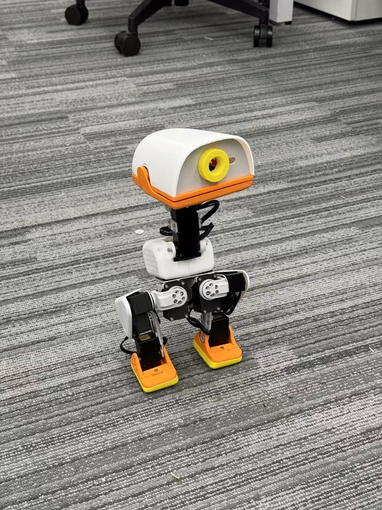

# Microduck-S288：从零做一只机器鸭

这个项目记录了我用 **S288 电机复刻 Microduck** 的过程：改结构、装电控、做标定，再把强化学习训练出来的策略放到真机上运行。

本方案不需要自己绘制pcb、焊接电路，复刻所用到的所有零部件均为市面上可以直接采购到的产品，对新手小白也友好。




*装配完成的 Microduck-S288。*

<!-- 待补：同版本站立、行走和转向视频。 -->

## 复刻教程持续更新完善中，欢迎大家关注小红书进群交流！


*群聊二维码有效期至 2026 年 11 月 13 日，失效后会更新。*


mcroduck整机使用 **15 个 S288**。其中左右腿各 5 个、颈部和头部 4 个，共 **14 个关节参与 RL 训练与策略控制**；第 15 个舵机不参与当前 RL。主控是 **Raspberry Pi Zero 2 W**，通过宇树官方 USB 电机通信板（UniArm L1 同款）控制电机，通过 **LSM6DSV16X IMU** 感知身体运动。

供电使用 **3S 航模锂电池 + Y 型分线**：一路接宇树电机通信板给电机供电，另一路接 12 V 转 5 V 降压模块，再给 Pi Zero 2 W 供电。

电脑负责仿真和训练，树莓派负责运行训练好的 ONNX 策略。仓库中已经包含对应的训练代码、仿真模型、标定工具、部署程序和一份预训练 ONNX。

模型文件下载和舵机编号的官方说明已放在安装篇。目前还在补充接线针脚、板卡采购型号、装配细节和关节零位照片。准备采购和打印时，先对照安装篇确认所需文件与规格。

## 获取代码

在电脑终端执行。这里显式指定本地文件夹名，与教程后面的路径保持一致：

```bash
git clone https://github.com/zj281136/microduck-s288.git microduck-s288-open-source
cd microduck-s288-open-source
```

当前以持续完善中的版本发布，已提供代码、预训练策略和制作主线；装配细节、零位参考及完整复现记录会继续更新。

## 教程按这五篇读就够了

| 顺序 | 文档 | 这一篇带你完成什么 |
| --- | --- | --- |
| 1 | [选型思路](docs/DESIGN_GUIDE.md) | 为什么用这套电机和电控，哪些东西可以换，哪些变化会影响训练 |
| 2 | [安装教程](docs/BUILD_GUIDE.md) | 电脑 USB 编号、接线测试 → 按图组装 → 整机通信复测 → 最后安装 Pi 与 IMU |
| 3 | [系统与代码安装、关节标定](docs/SOFTWARE_GUIDE.md) | 完成 Pi 与 IMU 的系统配置、读取检查，以及关节零位和方向标定 |
| 4 | [训练教程](docs/TRAIN_GUIDE.md) | 从一次小规模试跑开始，训练、观察动作，再导出自己的策略 |
| 5 | [部署教程](docs/07-deployment.md) | 用预训练或自己训练的策略，先站立，再低速行走，最后键盘遥控 |

**只想先做出一只：**按 1 → 2 → 3 → 5 阅读，跳过训练，用配套 ONNX。

**想自己训练：**完成硬件准备后再读第 4 篇。训练和部署使用同一套模型、关节顺序与反馈定义，改硬件时也要一起考虑它们。

每篇会尽量把当前步骤需要的内容放在一起，说明命令在哪里运行、做完应该看到什么。旧的分章资料保留作查阅，第一次制作不用逐篇翻完。

## 开始前，准备好这几样东西

除了机器人零件，你还需要一台能连接树莓派的电脑、合适的装配工具，以及能托住整机的支撑或防坠架。只有自己训练时，才需要额外准备支持 CUDA 的 NVIDIA GPU 电脑。

第一次调试时，电机有时会卸力，机器人不会一直自己站着。先准备好支撑和动力切断，再接通电机。每台机器的零位都要自己标定，不能直接复制别人的标定文件。

还有一个容易误会的地方：这里的部署程序是在树莓派上运行的 Python 代码。给存储卡写系统、复制程序、安装依赖之后就能运行，**不是把 ONNX 烧进电机**。S288 与通信板的固件烧录方法，目前还不在本仓库的完整教程范围内。

## 代码和文件放在哪里？

```text
software/training/       仿真模型、执行器和强化学习训练代码
software/deployment/     树莓派运行程序、标定工具和配套 ONNX
cad/                    结构源文件下载说明（文件通过 Release 提供）
print/                  打印资源下载说明
assembly-drawings/       装配图与紧固件说明（待补齐）
docs/                   上面五篇主教程及补充资料
```

## 致谢与许可

这个项目基于 [Pollen Robotics Microduck](https://github.com/pollen-robotics/microduck) 和 [Microduck RL](https://github.com/pollen-robotics/microduck_rl)，也用到了 mjlab、Rhoban BAM 与 UniArmL1 的工作。感谢原作者开放设计与代码，也感谢 microduck-replica 对复刻资料的整理。

仓库包含不同来源的代码与资源，使用和再发布时请同时查看 [NOTICE](NOTICE.md) 与 [第三方许可说明](THIRD_PARTY_NOTICES.md)。
