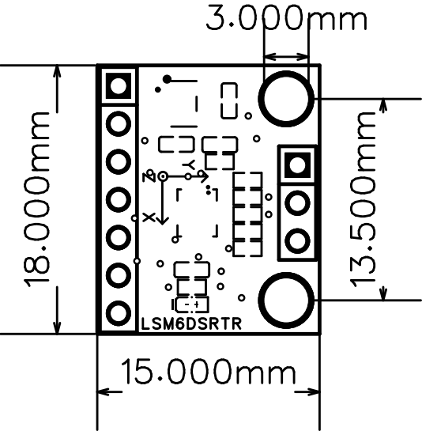
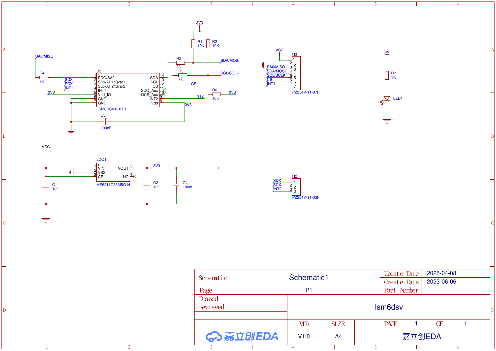

# 给电脑和Pi准备好软件

先按安装篇，用电脑通过 USB 完成舵机编号、接线与多电机测试，按装配图组装，再用同一台电脑复测整机电机通信。完成这些步骤后，才按本篇安装、配置 Pi 与 IMU。

软件分两边：电脑负责前期 USB 通信测试，以及可选的仿真训练；Pi 负责机载运行。使用预训练策略时不需要训练环境，但前面的电脑通信测试仍要完成。

下面会注明命令在哪个目录执行。遇到报错时，先确认当前Python和所在环境，往往比重复安装一遍更容易找到原因。

## 1. 两边各做什么？

| 环境 | 作用 | 主要依赖 |
| --- | --- | --- |
| 开发/训练电脑 | 仿真、PPO、checkpoint、ONNX 导出 | Python3.12、mjlab、MuJoCo Warp、PyTorch、CUDA |
| Raspberry Pi | IMU、串口电机通信、ONNX 推理与日志 | NumPy、ONNX Runtime、pyserial、smbus2 |

仅使用预训练模型时不需要先安装训练环境。不要把电脑虚拟环境直接复制到 Pi，也不要在 Pi 上安装整套 CUDA 训练依赖。

## 2. 给树莓派烧录系统

这里的“烧录”，就是把操作系统写进 microSD 卡。我们采用不接显示器和键盘的方式：提前填好 Wi-Fi 和登录信息，开机后从电脑远程操作树莓派。

### 2.1 准备好这些东西

- Raspberry Pi Zero 2 W。
- 一张 microSD 卡，建议准备 32 GB，方便后面存放代码和日志。
- 一个能在电脑上读取这张卡的读卡器。
- 一台 Windows、macOS 或 Linux 电脑。
- 给树莓派供电的稳定 5 V 电源与 Micro USB 线。
- 一个电脑和树莓派都能连接的 **2.4 GHz Wi-Fi**；Zero 2 W 不支持 5 GHz Wi-Fi。

这一步先单独准备树莓派，不接通电机动力。树莓派板上的供电口标为 `PWR IN`，另一个 `USB` 口用于数据连接，后面接电机通信板时会用到。

### 2.2 安装官方写卡工具

在电脑上下载并安装 [Raspberry Pi Imager](https://www.raspberrypi.com/software/)。把 microSD 卡插进读卡器，再接到电脑。

打开 Imager，按提示选择：

| 项目 | 选择什么 |
| --- | --- |
| 设备 / Device | Raspberry Pi Zero 2 W |
| 操作系统 / OS | Raspberry Pi OS Lite **(64-bit)**，通常在 Raspberry Pi OS (other) 分类下 |
| 存储设备 / Storage | 刚插入的 microSD 卡，核对容量和设备名称 |

Lite 是没有桌面的版本，我们后面通过终端操作它即可。Zero 2 W 支持 64 位 Raspberry Pi OS；本教程选择 64 位系统，也方便后续安装 aarch64 的 Python 运行依赖。镜像分类和名称可能随 Imager 版本略有调整，认准 **Lite、64-bit** 即可。[官方系统列表](https://www.raspberrypi.com/software/operating-systems/)列出了支持的设备。

**写入会清空选中的存储设备。** 卡里有资料先备份，尤其不要把电脑上的移动硬盘选成目标。

### 2.3 写入前，把联网和登录信息填好

进入系统自定义设置（Customisation）。不同版本的 Imager 可能把这些设置分成多个页面，依次填写下面几项：

| 设置 | 本教程的示例 | 用途 |
| --- | --- | --- |
| 主机名 / Hostname | `microduck` | 之后用 `microduck.local` 找到树莓派 |
| 用户名 / Username | `duck` | SSH 登录和运行程序的账号 |
| 密码 / Password | 自己设置并记住 | 远程登录时使用 |
| Wi-Fi | 家中路由器的名称与密码 | 让树莓派开机后自动联网 |
| 无线网络国家/地区 | 按实际使用地点选择 | 使用对应地区的无线设置 |
| 时区 / Time zone | 按所在地选择，例如 `Asia/Shanghai` | 让日志时间容易对应 |
| 远程访问 / Remote Access | 开启 SSH，选择密码认证 | 允许从电脑终端登录 |

`duck` 是我们在这里自己创建的示例账号，不是系统默认账号。你也可以用别的名字，后面的 SSH 和复制命令一起替换就好。

Wi-Fi 名称和密码注意大小写，并确认填的是 2.4 GHz 网络。如果路由器把两个频段分成不同名称，选择 2.4 GHz 那一个。

保存设置，确认使用这些设置后开始写入。等 Imager 完成写入和校验，再安全弹出存储卡。整个流程可对照[官方写卡说明](https://www.raspberrypi.com/documentation/computers/getting-started.html#install-using-imager)，实际按钮位置以你安装的版本为准。

<!-- 配图位置：Imager 的设备、系统与存储卡选择，以及自定义设置；截图中隐藏 Wi-Fi 密码。 -->

### 2.4 插卡，第一次开机

树莓派断电时插入 microSD 卡，再把电源接到 `PWR IN`。让电脑也连上同一路由器的网络。

第一次启动要初始化系统，可能需要几分钟，先给它一些时间，不要刚上电就反复拔电。随后在电脑的终端里执行，Windows 可以使用 PowerShell：

```bash
ssh duck@microduck.local
```

这里的 `duck` 和 `microduck` 分别对应刚才填写的用户名和主机名。首次连接会询问是否信任这台主机；确认连接的是自己的树莓派后输入 `yes`，再输入刚设置的密码。输入密码时屏幕不显示字符，这是正常的。

成功后会看到类似提示符：

```text
duck@microduck:~ $
```

从现在起，在这个 SSH 窗口里输入的命令都由树莓派执行。[官方 SSH 说明](https://www.raspberrypi.com/documentation/computers/remote-access.html#connect-to-an-ssh-server)也使用相同的登录方式。

如果 `microduck.local` 无法解析，打开路由器的已连接设备列表，找到树莓派的 IP，再用 IP 登录。例如实际地址为 `192.168.1.123` 时：

```bash
ssh duck@192.168.1.123
```

这里的 IP 只是示例，必须换成路由器里看到的实际地址。电脑可以连接同一路由器的 5 GHz 网络，但两台设备之间不能被访客网络或设备隔离设置阻断。

### 2.5 登录后，做一次基础检查

下面开始在**树莓派的 SSH 窗口**里操作：

```bash
cat /etc/os-release
uname -m
python3 --version
```

`uname -m` 应显示 `aarch64`，表示当前运行的是 64 位系统。把系统和 Python 版本记录下来，后面安装依赖失败时会用到。训练电脑要求 Python 3.12；树莓派运行环境则以它的 Python 与 ONNX Runtime 软件包兼容性为准，两边不必强行装成同一版本。

安装后面要用到的基础工具：

```bash
sudo apt update
sudo apt install -y python3-venv python3-pip
```

这些命令安装系统工具，机器人运行依赖仍会装进项目的 `.venv`。

### 2.6 连不上时，先按现象检查

| 现象 | 先检查什么 |
| --- | --- |
| 路由器里找不到树莓派 | 首次启动是否完成、供电是否稳定、Wi-Fi 名称和密码是否正确、是否为 2.4 GHz 网络 |
| `Could not resolve hostname` | 主机名是否填对；改用路由器里查到的 IP |
| `Connection timed out` | IP 是否正确，两台设备是否在可互通的网络，是否启用了访客隔离 |
| `Connection refused` | 是否在 Imager 中开启 SSH，系统是否已完成启动 |
| `Permission denied` | 是否使用自己创建的用户名和密码，而不是套用旧教程的默认账号 |

烧录完成的判断很简单：电脑能通过 SSH 登录，树莓派能显示系统信息，且架构为 `aarch64`。到这里再安装项目代码。

## 3. 把工程复制到树莓派

在电脑终端下载工程，显式指定目录名，与后面的命令保持一致：

```bash
git clone https://github.com/zj281136/microduck-s288.git microduck-s288-open-source
```

已经下载过工程就不用重复克隆。保留目录关系，尤其是部署目录下的 `teleop/scripts` 和 `teleop/robot_control`。

在**电脑上另开一个终端**，进入 `microduck-s288-open-source` 的上一级目录，执行：

```bash
scp -r microduck-s288-open-source duck@microduck.local:~/
```

如果前面用 IP 才能登录，这里也把 `microduck.local` 换成同一个 IP。复制的是项目文件，电脑上的虚拟环境不要一起搬到树莓派使用。

复制完成后，回到**树莓派的 SSH 窗口**：

```bash
cd ~/microduck-s288-open-source
ls software/deployment
```

应能看到 `deploy.py`、`setup_pi.sh` 和 `teleop` 等内容。接下来从这个仓库根目录继续执行。

## 4. Pi 运行环境

在 Pi 的部署目录执行：

```bash
cd software/deployment
python3 -m venv .venv
.venv/bin/python -m pip install -r teleop/scripts/requirements_pi_deploy.txt
```

这里的 `cd` 相对仓库根目录；如果部署目录被单独复制，应进入实际复制位置。安装会访问软件源，需要可用网络。

现有 requirements 包括：

| 依赖 | 功能 |
| --- | --- |
| NumPy | 观测与动作数组 |
| ONNX Runtime | 策略推理 |
| pyserial | 电机控制器串口 |
| smbus2 | IMU I2C 访问 |

版本范围以 requirements 文件为准。安装失败时先记录 Python、系统架构、错误包名和 wheel 兼容问题，不通过混用系统 Python 与其他虚拟环境解决。

## 5. 安装 IMU，并通过 I2C 与树莓派通信

这版使用 **LSM6DSV16X，通过 I2C 直接连接 Pi Zero 2 W**。原版的 **imu_to_dxl** 板用于把 IMU 接入 Dynamixel 总线，我们免去打板制作流程，而是由树莓派通过 GPIO 上的 SDA/SCL 直接读取 IMU，再由本项目的 Python 驱动处理角速度和重力方向。因此，复刻这一版时不需要准备 `imu_to_dxl`，也不需要安装或烧录它的固件。

电机走 USB 通信板，IMU 走树莓派的 I2C，两条通信路径互相独立。下面就按这套接法安装和测试。

先让 IMU 单独读出稳定数据，再启动整机程序。下面的检测不打开电机串口，测试期间可以保持电机动力断开。

### 5.1 先定安装位置和朝向

IMU 测量的是它自己所在位置的运动。我们需要它反映躯干状态，因此把模块固定在与躯干刚性连接的位置，不能随头部或腿部关节单独转动。安装面要平整、固定可靠，并避免板子背面的焊点碰到金属件。

下面是这台鸭子的 IMU 安装近照。先对照看模块在机体里的位置和走线，再按后面的接线表逐根核对端子。

<p align="center">
  
</p>
*实物照片用于说明安装位置；各根线的功能按端子定义和接线表核对。*

当前驱动 `teleop/robot_control/imu/lsm6dsv16x.py` **没有安装旋转矩阵或自动换轴功能**，直接按下面的对应关系读取传感器：

| 传感器轴 | 对应机器人方向 |
| --- | --- |
| +X | 鸭子正前方 |
| +Y | 鸭子左侧 |
| +Z | 鸭子上方 |

先根据模块的轴标记和厂家轴向图摆正，再固定。不能只凭“芯片朝上”判断方向。如果安装空间确实要求转着装，需要在驱动里对加速度和角速度一起做正确的坐标旋转，再重新验证；启动时的静止校准只能估计陀螺偏置，不能替代换轴。

线束在模块旁留一点余量，并固定到结构上，避免运动时拉扯接口。不要让板子松垮地挂在线上，也不要用会明显晃动的安装方式。

下面是随模块资料提供的尺寸图，能看到轴向标记。板外形为 **15 × 18 mm**，图中标注了 3 mm 安装孔及 13.5 mm 孔距；做支架时再与实物核对。

<p align="center">
  
</p>
这张图用于辨认模块尺寸和传感器轴，不是机器人安装照片。安装后仍要完成后面的姿态检查。

### 5.2 断电后接好供电、I2C 和地址选择线

先正常关机，再断开树莓派供电后接线：

```bash
sudo poweroff
```

现在有了这块模块的原理图，可以直接按 **H3 七针接口**查线。注意它与裸芯片的引脚编号不同，也与树莓派的物理针脚编号不同。

| 模块 H3 引脚 | 原理图名称 | I2C 模式下怎么接 |
| --- | --- | --- |
| 1 | VCC | 接 Pi 物理 1 脚（3.3 V），与本项目实物接法一致 |
| 2 | GND | 接 Pi 物理 6 脚 GND，与 Pi 共地 |
| 3 | SA0/MISO | 接 GND，选择 `0x6a` 地址 |
| 4 | SDA/MOSI | 接 Pi 物理 3 脚，GPIO2 / SDA1 |
| 5 | SCL/SCLK | 接 Pi 物理 5 脚，GPIO3 / SCL1 |
| 6 | CS | 本图中经 R6（10 kΩ）上拉到板内 3V3，I2C 模式下保持高电平，无需接 Pi 的 SPI 片选 |
| 7 | INT1 | 当前轮询驱动不使用，可不接 |

`SDA/MOSI` 和 `SCL/SCLK` 是复用端子的名称，我们使用其中的 I2C 功能。SDA 接 SDA，SCL 接 SCL，不交叉；`SA0/MISO` 在这里用于选地址，不接 Pi 的 SPI MISO。

```text
Pi Zero 2 W                       模块 H3 接口
GND（物理 6）──────────────────── 2：GND
GPIO2 / SDA1（物理 3）──────────── 4：SDA/MOSI
GPIO3 / SCL1（物理 5）──────────── 5：SCL/SCLK
GND ───────────────────────────── 3：SA0/MISO → 地址 0x6a
3.3 V（物理 1）────────────────── 1：VCC
                                  6：CS，板载上拉，保持高电平
                                  7：INT1，当前不接
```

本项目实物采用 **Pi 物理 1 脚（3.3 V）→ 模块 H3.1 VCC** 的供电接法，复刻时按上表连接。原理图中的 VCC 仍是板载 ME6211C33M5G-N 稳压器输入，与图中的内部 `3V3` 是不同节点；这里记录的是实物接线，不表示已测得稳压器输出恰好为 3.3 V。

SDA/SCL 已分别通过 R1/R2（10 kΩ）上拉到板内 3V3。不要再把信号线上拉到 5 V，也不要把电机动力电源接到 IMU。Pi 的物理 3 脚是 GPIO2，物理 5 脚是 GPIO3，数针脚时按板上 1 脚标记定位。

<p align="center">
  
</p>
需要放大看网络连接时，打开[原理图 PDF](../../hardware/imu/lsm6dsv16x/module-schematic.pdf)。上面的接法依据这份模块资料，换其他厂家的模块时重新核对端子定义。Zero 2 W 如果没有安装排针，先准备可靠连接，不把线松插在焊孔里。

模块另一侧的 H2 接口是 `SDX/SCX/INT2`，不是本教程连接树莓派的主 I2C 端口。CS 拉高启用 I2C，SA0 接地对应 `0x6a`；若选择 `0x6b`，SA0 应置于板内 I/O 电源的高电平。接口说明可查项目内保存的[芯片手册第 21–22 页](../../hardware/imu/lsm6dsv16x/lsm6dsv16x-datasheet.pdf)。

### 5.3 开启树莓派的 I2C

检查接线后重新给树莓派供电，SSH 登录。在**树莓派终端**执行：

```bash
sudo raspi-config
```

进入 `Interface Options → I2C`，选择启用，再退出。菜单编号可能变化，按名称查找即可。[官方配置说明](https://www.raspberrypi.com/documentation/computers/configuration.html#enable-or-disable-i2c)也提供了这个入口。

安装检测工具，给当前用户配置访问权限，再重启：

```bash
sudo apt update
sudo apt install -y i2c-tools
sudo usermod -aG dialout,i2c "$USER"
sudo reboot
```

重启会断开 SSH。等树莓派重新联网后再登录，执行：

```bash
groups
ls -l /dev/i2c-1
```

应能看到用户属于 `i2c` 组，并且存在 `/dev/i2c-1`。`dialout` 组是后续 USB 电机串口要用的权限，顺手在这里配置好。

### 5.4 找到地址，再确认芯片身份

先停止其他正在读取 IMU 的程序，在只连接这块 IMU 的调试条件下扫描总线：

```bash
i2cdetect -y 1
```

表格中的 `6a` 代表检测到 `0x6a` 地址，不是报错；`--` 表示那个地址没有响应。如果出现 `6b`，后面的检测与部署都改用 `0x6b`，不必为了套示例而改硬件地址。

地址有响应还不能证明芯片型号正确。回到**部署目录**，使用前一节已经安装好的虚拟环境读取 `WHO_AM_I`：

```bash
cd ~/microduck-s288-open-source/software/deployment
.venv/bin/python - <<'PY'
from smbus2 import SMBus

address = 0x6a  # 扫描到 0x6b 时，改这里
with SMBus(1) as bus:
    chip_id = bus.read_byte_data(address, 0x0f)
print(f"WHO_AM_I = 0x{chip_id:02x}")
if chip_id != 0x70:
    raise SystemExit("芯片 ID 与当前 LSM6DSV16X 驱动不匹配，请核对模块型号。")
PY
```

当前驱动期望输出 `WHO_AM_I = 0x70`。如果不一致，先核对实际芯片型号；不能只改驱动里的期望值让检查通过。

### 5.5 先用独立脚本看原始数据

资料里的 I2C 检测脚本已经收进项目。仍在 `software/deployment` 目录中执行：

```bash
.venv/bin/python ../diagnostics/read_imu_i2c.py \
  --bus 1 --address 0x6a --duration 10 --print-rate 5
```

它先核对 `WHO_AM_I`，再配置为加速度 ±4 g、陀螺仪 ±1000 dps、120 Hz，输出 `a`（加速度）、`|a|`（加速度模长）、`w`（角速度）、温度和读取数据率。静止时 `|a|` 应接近 9.8 m/s²；角速度可能有小偏置，因为这个工具没有做部署驱动的静止校准。

脚本报告的是传感器原生轴，不计算机器人姿态或重力方向。`rate` 是程序读到数据的速率统计，不是完整通信延迟；观察是否持续更新、有无明显断续即可，不把短窗口里的精确数值当作性能保证。

运行到 10 秒会尝试关闭传感器采样，也可用 Ctrl+C 结束。脚本不连接电机，下一步换用项目驱动之前，先让它退出。

### 5.6 再用部署驱动检查重力方向

仍在 `software/deployment` 目录运行下面的代码。先把机器人扶正、放稳，前三秒保持静止，用来估计陀螺偏置。校准结束后才开始缓慢改变姿态：

```bash
.venv/bin/python - <<'PY'
import sys
import time

sys.path.insert(0, "teleop")
from robot_control.imu.lsm6dsv16x import LSM6DSV16X

imu = LSM6DSV16X(bus=1, address=0x6a)  # 按扫描结果选择地址
try:
    print("保持机器人直立、静止，开始 3 秒校准……", flush=True)
    imu.start(calibration_seconds=3.0)
    time.sleep(0.1)  # 等待后台线程发布首帧
    print("校准完成，接下来读 20 秒。可以缓慢倾斜机器人。", flush=True)
    deadline = time.monotonic() + 20.0
    while time.monotonic() < deadline:
        sample = imu.latest(max_age_s=0.05)
        gyro = sample.angular_velocity_rad_s.round(3).tolist()
        accel = sample.accel_m_s2.round(3).tolist()
        gravity = sample.projected_gravity.round(3).tolist()
        age_ms = (time.monotonic() - sample.timestamp) * 1000.0
        print(f"gyro={gyro} accel={accel} gravity={gravity} age_ms={age_ms:.1f}")
        time.sleep(0.2)
except KeyboardInterrupt:
    print("结束 IMU 检查。")
finally:
    imu.close()
PY
```

这段代码只配置并读取 IMU，不导入电机控制器，也不发送电机指令。每秒打印约 5 行只是方便观察，不等于采样只有 5 Hz：当前驱动将加速度计和陀螺仪配置为 120 Hz，并在后台持续采集。

输出里的 `gyro` 单位是 rad/s，`accel` 是 m/s²，`gravity` 是归一化重力方向。`age_ms` 是当前时刻距离驱动生成这一帧的时间，不是芯片的完整测量延迟。

### 5.7 判断朝向是否正确

先静置看数值，再慢慢改变姿态。不要只以“有数据滚动”作为验收结果。

| 操作 | 应观察到什么 |
| --- | --- |
| 机器人直立、静止 | `gyro` 接近 `[0, 0, 0]`，`accel` 接近 `[0, 0, 9.8]`，`gravity` 接近 `[0, 0, -1]` |
| 缓慢向前后俯仰 | 转动时主要是 `gyro` 的 Y 分量变化；停下后重力方向仍反映倾斜 |
| 缓慢向左右侧倾 | 转动时主要是 `gyro` 的 X 分量变化 |
| 从上方看逆时针转动机体 | 转动时 `gyro` 的 Z 分量应为正；停止后回到接近零 |

实际手扶操作会有耦合和噪声，不要求另外两轴严格为零。但如果俯仰主要变成 X 轴、侧倾变成 Y 轴，就要重新核对安装朝向。重力估计有滤波，缓慢倾斜后留一点时间观察，不用快速甩动来测试。

注意加速度计静止时的 +Z 与重力方向的 -Z 符号相反，这是当前驱动的定义，不是接反。这个六轴方案也没有绝对航向参考，水平静止时重力方向不能验证 yaw；yaw 要看转动过程中的角速度。

### 5.8 把相同的地址交给部署程序

后面的站立或键盘命令使用相同的总线与地址，例如：

```text
--i2c-bus 1 --i2c-address 0x6a
```

若扫描到 `0x6b`，将 `--i2c-address` 改成 `0x6b`。每次部署启动仍会重新进行静止校准。先退出上面的独立检测，再启动部署，避免两个程序同时改写同一颗 IMU 的寄存器。

### 5.9 通信出问题时怎么查

| 现象 | 先回查什么 |
| --- | --- |
| 没有 `/dev/i2c-1` | I2C 是否启用，是否已经重启 |
| `Permission denied` | 当前用户是否在 `i2c` 组，是否已重新登录 |
| 扫描不到 `6a` 或 `6b` | 模块供电、共地、SDA/SCL 是否接反、物理针脚是否数错、模块是否处于 I2C 模式 |
| `Remote I/O error` / 超时 | 地址是否写对、连接是否松动、模块供电和总线是否稳定 |
| `WHO_AM_I mismatch` | 是否真是 LSM6DSV16X，是否选中了另一颗设备 |
| `robot moved during gyro calibration` | 校准前三秒是否移动、安装是否松动、有无持续振动 |
| `invalid stationary acceleration magnitude` | 校准时是否静止、芯片型号是否匹配 |
| `stale IMU sample` | 后台采样是否正常、I2C 是否断续、系统是否有明显调度卡顿 |

以上代码已按仓库当前驱动接口核对，但本次文档修改没有连接实物执行。实际安装时请保留自己的静止和倾斜读数，确认通信、安装方向都正确后，再进入电机标定与整机站立。

## 6. 训练环境

在训练电脑进入：

```bash
cd software/training
uv sync --locked
```

依赖由 `pyproject.toml` 和 `uv.lock` 管理。`--locked` 用于检查安装与记录的依赖解析是否一致，不能保证未知 GPU 驱动或系统平台一定可用。

BAM 来源、protobuf/ONNX 的版本约束，以及 aarch64 的 PyTorch CUDA 路由均保留在项目配置中。依赖问题应先核对锁文件，不建议靠未记录的手动安装形成不可复现环境。

## 7. 下一步

- Pi：进入[通讯与标定](../04-motor-calibration.md)，先处理零增益反馈，不直接启动站立。
- 训练机：进入[训练教程](../06-training.md)，确认唯一 task、模型和参数。
- 已装环境但模型加载失败：按[故障排查](../08-troubleshooting.md)核对模型接口及来源。
