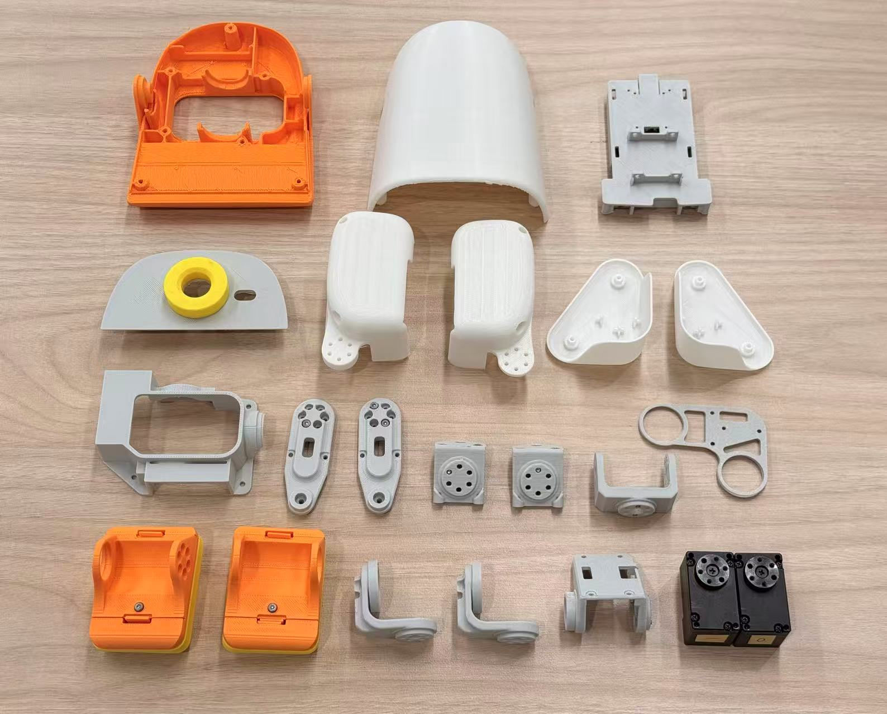
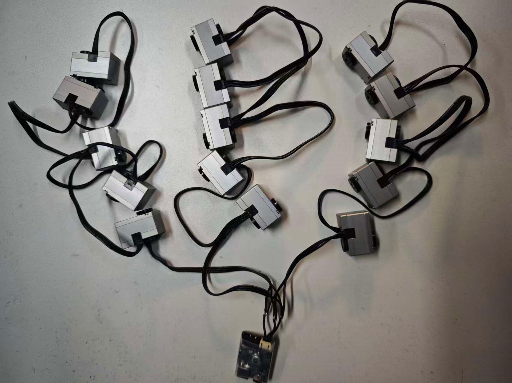
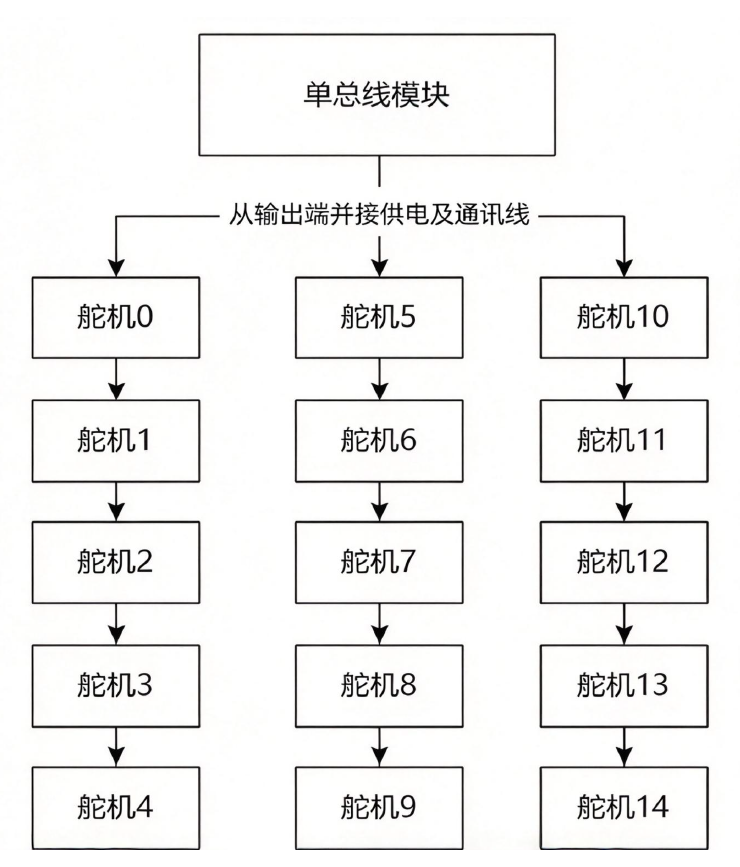
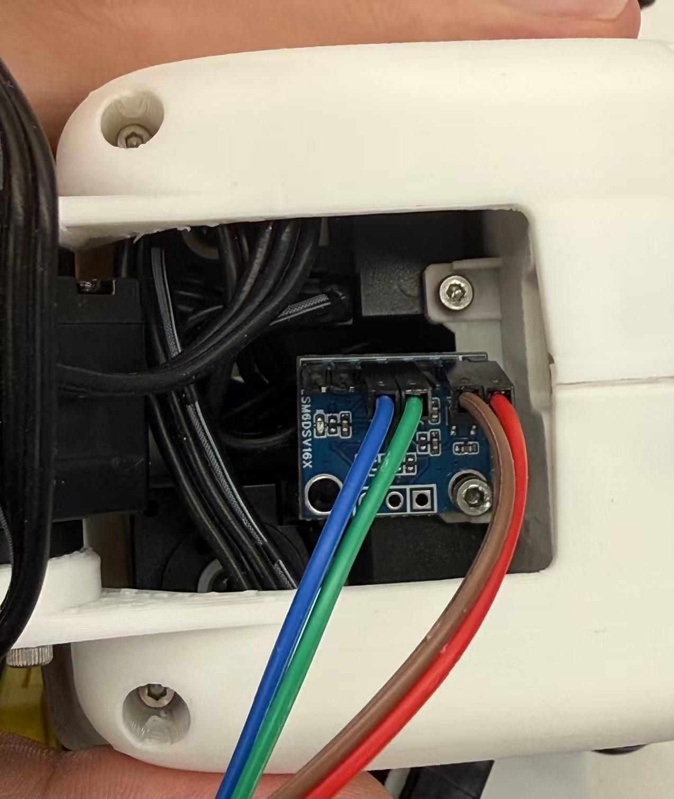

# 02 · 安装教程：把零件装成一只鸭子

这一篇按下面的顺序动手：

**电脑 USB 连接舵机 → 逐颗编号与接线 → 全总线通信测试 → 按装配图组装 → 电脑 USB 复测整机通信 → 最后安装、配置 Pi 和 IMU。**

前半程直接用电脑操作电机通信板，Pi 和 IMU 留到整机装好、通信复测正常后再处理。这样先确认电机和线束能正常通信，组装后再检查有没有夹线、松动，最后接上机载控制系统。

先下载下面的结构源文件，再按部件分组准备。螺丝与轴承规格、舵盘安装图和最终接线针脚还需要补充；涉及这些细节时，要结合对应图纸确认。

## 1. 先清点物料，别急着拧螺丝

按用途把物料分开放好。先取电脑、USB 电机通信板、电机电源、S288 和线束；Pi、系统卡、供电转换和 IMU 先留在一边，最后再安装。

| 分组 | 需要准备的东西 | 当前要确认什么 |
| --- | --- | --- |
| 电机 | S288 × 15，配套输出连接件 | 完整型号、固件、安装接口 |
| 电控 | Pi Zero 2 W × 1、USB 电机通信板 × 1、LSM6DSV16X × 1、系统卡 | 通信板与 IMU 模块的具体版本、接口和电平 |
| 供电与线束 | 电机动力电源、Pi 供电转换、开关与保护、USB/I2C/电机线 | 电压、电流、极性、接头与长度 |
| 机械与工具 | S288 打印件、轴承、紧固件、装配工具、支撑架 | 零件版本、螺丝长度和数量、配合尺寸 |

采购明细保留在 [BOM](../BOM.md)，核实后的型号和数量以那张表为准。现在表中还有未填写项，先不要凭名称买一套“差不多”的配件。

准备标签纸，给电机和线束留编号。建议在电机装进结构之前，先按本篇第 3 节逐颗写好 ID、核对回读，再贴上关节名称。电机藏进结构以后，再找某颗电机是哪一个，会比现在麻烦得多。

## 2. 下载模型文件

STL 与可编辑零件的下载入口：

[Microduck v0.1.0 模型文件](https://github.com/laotawayer/microduck/releases/tag/v0.1.0)

下面是部分结构件和舵机的平铺照片。可以先对照照片认识头壳、脚掌和连接支架，再按装配图分组清点。

<p align="center">
  
</p>
*图中展示部分零件，完整数量和左右件以装配图、BOM 为准。*

## 3. 给电机设置 ID，再贴上关节名称

编号时一次只连接一颗电机，按下表写入目标 ID，回读确认后贴上“ID + 关节名”标签，再断电更换下一颗。具体设置操作按[宇树 J288 / S288 官方快速入门](https://support.unitree.com/home/zh/J288-S288%20Servo/Quick_Start)设置舵机编号，关节与 ID 的对应关系见下表。

下面是整机 15 个舵机的**总线 ID**，不是网络输出数组顺序。ID 0–13 属于当前 RL 关节，ID 14 为非 RL 附加舵机：

| ID | 关节名 | 实物位置 |
| --- | --- | --- |
| 0 | head_roll | 头部侧倾 |
| 1 | head_yaw | 头部左右转 |
| 2 | head_pitch | 头部俯仰 |
| 3 | neck_pitch | 颈部俯仰 |
| 4 | right_hip_yaw | 右髋偏航 |
| 5 | left_hip_yaw | 左髋偏航 |
| 6 | left_hip_roll | 左髋侧倾 |
| 7 | left_hip_pitch | 左髋俯仰 |
| 8 | left_knee | 左膝 |
| 9 | left_ankle | 左踝 |
| 10 | right_hip_roll | 右髋侧倾 |
| 11 | right_hip_pitch | 右髋俯仰 |
| 12 | right_knee | 右膝 |
| 13 | right_ankle | 右踝 |
| 14 | 非 RL 附加舵机 | 按装配图安装，不进入当前 RL |

编号结束后，把“实物位置、标签名称、软件回读 ID”再对一次。贴标签和写入 ID 是两件事；本项目的 probe 用于读取反馈，标定工具用于零位与方向校正，它们不代替官方的 ID 设置流程。

## 4. 电脑 USB 连接电机总线，先在台架上接线

本项目使用**宇树官方 USB 电机通信板，UniArm L1 同款**，与 S288 电机从同一购买入口购入。备料时选择这块配套板卡即可，具体商品链接会与电机一起补入 BOM。

本项目使用 **3S 航模锂电池**供电。电池通过 Y 型线分成两路：一路接电机通信板，另一路留给后面安装的 Pi 降压模块。现在先测舵机，Pi 这一支暂不接入，空闲接头做好绝缘。电脑通过 USB 与通信板收发数据：

```text
电脑 ── USB ────────── 电机通信板 ── 电机总线 ── S288 × 15
3S 航模锂电池 ── Y 型线 ──┤
                          └─ Pi 供电支路，当前暂不接入
```

USB 接到电脑不等于电机已经有动力供电：电池这一支接通信板的动力输入，USB 负责主机通信。具体插头、针序和极性按实际板卡与线束核对，不根据线色判断。

断开动力后，先确认电源分配和开关，再接通信板与电机总线。线序、正负极和插头固定都确认好后，才上电测试；更换电机或分支前再次断电。这里先完成台架布线，最终线束会在组装时固定到机体上。

### 4.1 电机总线怎么分支

下面这段摘自[宇树官方「多电机强化学习部署例程」](https://support.unitree.com/home/zh/J288-S288%20Servo/Servo_learning_routine)，先看清楚电机数量、线长和波特率的关系，再决定怎么分支：

> J288/S288电机在单条总线上最多可支持15个电机（ID范围为0~14）。电机数量少时可全部串联通讯，当线缆连接长度较长/节点较多时，由于总线受到的干扰和寄生参数影响，会导致通信质量的下降。
>
> 对于单总线在一条总线上使用20cm的线缆连接各电机时，使用6Mbps的波特率时，一般工况极限不超过1并6串，或者2并4串；使用4Mbps的波特率时，不超过1并8串，或者3并5串。
>
> 在DIY双足小机器人的时候，我们强烈建议：
>
> 如需要在一条总线上使用15个电机，可以将电机改成4Mbps的波特率，分成3组，每组5个，3组通信线焊接到一起，不会出现丢包问题。
>
> 连接方式如图所示，请注意焊接时线缆线序不要接反，注意焊点绝缘不要短路。

“3 并 5 串”可以这样理解：从同一个总线模块分出三条支路，每条支路依次连接五颗电机。它们仍然共用一条总线，所以三组中的 ID 也必须互不重复。

<p align="center">
  
</p>
*图 1：分成三组连接的电机与总线模块。来源：宇树官方文档。*

<p align="center">
  
</p>
*图 2：3 并 5 串拓扑，图中的 15 颗电机使用 ID 0–14。来源：宇树官方文档。*

本项目整机使用 **15 颗 S288，总线 ID 为 0–14**。其中 ID 0–13 的 14 个关节参与当前 RL，ID 14 为非 RL 附加舵机。接线与全总线测试覆盖全部 15 颗，训练和策略控制仍保持 14 个关节；关节位置与 ID 按本项目编号表对应。

**当前仓库驱动固定使用 6 Mbps**，配置位于 `software/deployment/teleop/robot_control/arm/constants.py` 的 `BAUDRATE = 6000000`。官方上面的 15 电机、3 并 5 串建议以 **4 Mbps** 为条件；若采用这套建议，需要同步配置电机、通信适配器及主机驱动的波特率。仅改接线或仅改某一侧波特率，不能直接套用该结论。

焊接前按实际连接器确认线序，焊点分别绝缘，并留出关节活动时的线束余量。厂家建议对应其所述线长与一般工况；接好后仍先用本项目的零增益 probe 检查回包、超时和错误，通信正常后再进入机械组装。

## 5. 先在台架上测通多电机，再组装

电机还没藏进结构时，线束、插头和标签都看得见，最适合排查通信。先确认一颗能读，再分组测试，最后让全部 15 颗同时接在总线上接受轮询。**“单颗能读”不能代替“全部接入后也能稳定读”。**

这一节只检查电机总线，不需要 ONNX、IMU 或零位标定文件。先不装承力结构，也不运行 stand、keyboard 或方向标定。把电机摆稳、输出端留空，避免零增益时靠重力转动或拉扯线束；换线前断开动力。

### 5.1 准备测试电脑和最小环境

本节使用能访问 USB 电机通信板的 **Linux 电脑**，示例命令全部在这台电脑执行。直接把通信板 USB 接到电脑，Pi 和 IMU 还不用参与。

把通信板接到测试电脑，保持只有一个程序占用串口。先在**仓库根目录**执行：

```bash
cd software/deployment
python3 -m venv .venv
.venv/bin/python -m pip install 'numpy>=1.26,<3' 'pyserial>=3.5,<4'
ls -l /dev/serial/by-id/
```

这是电脑上运行 probe 所需的最小依赖。如果电脑已有这个环境，不用重新创建。以后换到 Pi 时，要在 Pi 上另建环境，不复制电脑的 `.venv`。

**本节余下命令都在 `software/deployment` 目录执行。** 示例端口为 `/dev/ttyACM0`，替换成你实际找到的设备，或使用对应的 `/dev/serial/by-id/...` 路径。遇到权限错误时，先给登录用户配置串口权限，再退出并重新登录：

```bash
sudo usermod -aG dialout "$USER"
```

确认电机、适配器和主机驱动的波特率一致。当前驱动使用 **6 Mbps**；如果已经按前面的官方建议把电机改成 4 Mbps，要先同步配置通信适配器和主机驱动，不能直接照默认配置运行。

### 5.2 从一颗电机开始

先只接已经编号为 ID 0 的电机，确认供电和线序，再运行：

```bash
.venv/bin/python deploy.py probe \
  --port /dev/ttyACM0 --ids 0 --samples 3
```

如果先接的是其他 ID，就相应修改 `--ids`。这里不是扫描未知地址，而是向你指定的地址请求反馈。

应看到三条 JSON 反馈，`id` 为 0，位置、速度和电压有有限数值，`motor_error` 与 `extra_error` 为 0。出现 `error`、超时、CRC 或 ID 错误时，先检查这一个节点，不继续增加电机。

probe 发送的是 `Kp=0、Kd=0、torque=0、speed=0` 请求，不主动跟踪位置，但它确实会打开串口、发送协议帧。它不是仅列出 USB 设备的检查。

### 5.3 每组单独测试

单颗正常后，按实际布线逐组接入。可以按关节用途清点为三组：头颈与非 RL 附加舵机共 5 颗、左腿 5 颗、右腿 5 颗。先每组单独连接，另外两组断开；每次更换接线先断电。

头颈与非 RL 附加舵机组：

```bash
.venv/bin/python deploy.py probe \
  --port /dev/ttyACM0 --ids 0 1 2 3 14 --samples 10
```

左腿组：

```bash
.venv/bin/python deploy.py probe \
  --port /dev/ttyACM0 --ids 5 6 7 8 9 --samples 10
```

右腿组：

```bash
.venv/bin/python deploy.py probe \
  --port /dev/ttyACM0 --ids 4 10 11 12 13 --samples 10
```

`--samples 10` 表示对所选 ID 轮询十轮，不是总共读十颗，也不是运行十秒。三个分组各应有 50 条请求结果。检查每个 ID 都持续有反馈，而不是只看终端里偶尔出现一行。

这个分组用于清点和定位故障，最终总线拓扑还要遵守上一节的波特率与分支条件。分组各自正常后，再接成准备装进机器人的完整线束。

### 5.4 全部 15 颗同时接入，再轮询一遍

确认全总线没有重复 ID，使用默认的 ID 0–14：

```bash
.venv/bin/python deploy.py probe \
  --port /dev/ttyACM0 --samples 3
```

程序按 ID 0 到 14 依次请求，重复三轮，正常完成时会输出 45 条请求结果。电机是全部接在总线上的，但请求与反馈按顺序进行，不是 15 颗同一时刻采样。

先看一轮短测试，确认没有整组缺失或接入后立刻报错，再做下一步连续轮询。

### 5.5 保存一次完整测试，并按 ID 统计

连续轮询 100 轮，把结果保存下来：

```bash
.venv/bin/python deploy.py probe \
  --port /dev/ttyACM0 --samples 100 > bus_probe.jsonl
echo "probe exit code: $?"
```

正常应得到 **1500 条结果，每个 ID 各 100 条**。重定向后终端不再滚动显示反馈，程序结束后才会打印退出码。退出码非零时先查看报错；即使退出码是 0，也还要检查电机状态码，因为当前 probe 不会仅因 `motor_error` 非零而返回失败。

下面这段代码只分析刚保存的文件，不访问硬件：

```bash
.venv/bin/python - <<'PY'
import json
import math
from pathlib import Path

rows = [json.loads(line) for line in Path("bus_probe.jsonl").read_text().splitlines() if line.strip()]
expected_rounds = 100  # 上面的 --samples 改了，这里一起改
fields = ("q_rotor_equiv_rad", "qdot_rotor_equiv_rad_s", "voltage", "torque_nm")
all_ok = len(rows) == 15 * expected_rounds
print("ID  请求结果  有效反馈  状态及数值正常")
for motor_id in range(15):
    selected = [row for row in rows if row.get("id") == motor_id]
    received = [row for row in selected if "error" not in row]
    healthy = [row for row in received
               if row.get("motor_error") == 0 and row.get("extra_error") == 0
               and all(isinstance(row.get(key), (int, float)) and math.isfinite(row[key]) for key in fields)]
    print(f"{motor_id:2d}  {len(selected):8d}  {len(received):8d}  {len(healthy):14d}")
    all_ok = all_ok and len(selected) == len(received) == len(healthy) == expected_rounds
print("本次轮询检查通过" if all_ok else "结果不完整或存在异常，请检查原始日志")
raise SystemExit(0 if all_ok else 1)
PY
```

这次统计检查的是回包完整性、状态码和数值是否有限，不证明电压满足负载要求，也不证明已经达到真机控制的 50 Hz。probe 的零增益轮询、终端输出与实际控制循环不同；100 轮没有错误，也不能保证运动和长期运行中永远不丢包。

保留这份日志，同时记下波特率、每段线长、分支方式和供电条件。后面装进机体后，用同样命令复测，才能看出布线、接头或结构挤压有没有引入新问题。

### 5.6 出问题时，从最后接入的一段查起

| 现象 | 先做什么 |
| --- | --- |
| 一颗都没有反馈 | 查设备名、串口权限、电机动力、适配器和各端波特率 |
| 只有某个 ID 缺失 | 断电后把对应电机单独接入，核对编号、接头与线缆 |
| 单组正常，全接上就报错 | 回查分支、线长、重复 ID、供电和连接点；逐组接入复测 |
| 同一支路后面的电机一起缺失 | 断电检查该支路最前面的异常连接点 |
| 偶发 CRC、超时或 ID 错误 | 保存日志，一次只改变线缆、接头、拓扑或供电中的一项再比较 |
| 有反馈，但电机状态码非零 | 按厂家故障码排查；读到了数据不等于电机状态正常 |

不要靠同时增大超时、放宽保护和换多个参数来让报错消失，那样很难知道真正修好了哪一处。

**单颗、分组和全总线测试都正常后，再进入机械组装。** 此时还没有捕获零位：机械安装会决定最终零位，等结构装好后再做零位与方向标定。

## 6. 通信测通后再装腿：先完成一侧，再对照另一侧

先确认上一节的全总线测试和日志检查正常，再打开对应装配图，核对零件位置、舵机编号和舵盘安装方向。接下来断开电机动力，按装配图逐步组装。

先把单侧的脚掌、脚踝、小腿、膝部及髋部零件放在一起。按“脚掌 → 脚踝 → 小腿与膝 → 髋部”的顺序试装，每接好一处，就检查这一处的连接面、轴心和运动空间。

这时重点看三件事：螺丝有没有顶底或伸进运动空间，轴承有没有被侧向挤压，关节转动时线会不会被夹住或拉紧。孔位不合适时先回查零件版本，不要靠强行锁紧把它拉到一起。

一侧确认后再做另一侧。左右件有镜像关系，不能把第一侧的舵盘朝向原样复制过去。舵盘机械角度必须对照模型零位与装配图；这一部分的准确图示还需要补充。

<!-- 待补实物图：脚踝、膝、髋的分步装配，标明螺丝规格、支撑侧和舵盘朝向。 -->

## 7. 装躯干，再装颈部与头部

按装配图把两条腿接到躯干，安装颈部和头部结构，并把电机线束按预定路径固定。Pi 和 IMU 的位置、固定孔和走线空间先预留好，等整机电机通信复测通过后再安装它们。电池按图固定，动作时不能在身体里滑动；线束不能压在连接面里，也不要靠连接器来承受拉力。

需要打开才能安装 Pi、IMU 或检查总线接头的外壳先不封死。

颈部到头部的关节依次是 `neck_pitch → head_pitch → head_yaw → head_roll`。每装一层就检查活动范围，再装下一层。整机共安装 15 个舵机，第 15 个按装配图安装，但不进入当前 14 关节 RL 策略。

<!-- 待补实物图：躯干内部布局、电池固定、头部四轴连接、Pi 和 IMU 预留安装位置。 -->

## 8. 仍用电脑 USB，复测装好的整机电机通信

先断电检查各个接头，确认电池固定可靠，线束不被结构夹住。再让关节在允许范围内缓慢活动，尤其检查髋部和颈部线束：静止时够长，转动时未必够长。

把整机放到能承重的支架上，通信板 USB **仍连接刚才测试的电脑**，继续使用相同的电源、波特率和程序。先测短轮询：

```bash
.venv/bin/python deploy.py probe \
  --port /dev/ttyACM0 --samples 3
```

正常时应有 45 条请求结果。再保存装配后的 100 轮测试：

```bash
.venv/bin/python deploy.py probe \
  --port /dev/ttyACM0 --samples 100 > bus_probe_assembled.jsonl
echo "probe exit code: $?"
```

仍在电脑的 `software/deployment` 目录执行。将第 5.5 节统计代码中的 `Path("bus_probe.jsonl")` 改为 `Path("bus_probe_assembled.jsonl")` 再运行，检查每个 ID 是否都有 100 条正常反馈。保留装配前的 `bus_probe.jsonl` 作对照，不覆盖它。

如果台架测试正常，装好以后却开始超时或缺回包，先回查刚固定、穿线或封壳的位置。确认 15 颗都能正常通信后，再结束电脑端测试、断开动力，进入下一节。

## 9. 整机通信通过后，最后安装和配置 Pi、IMU

到这里，舵机、线束和机械结构已经用电脑验证过。接下来才把机载主控和传感器装上，让 Pi 接替电脑，通过同一块 USB 通信板访问电机。

### 9.1 安装 Pi，准备系统和运行环境

先断开电池，按装配图固定 Pi 和 **12 V 转 5 V 降压模块**，检查板背绝缘、插头空间和线束余量。将之前预留的 Y 型线支路接到降压模块输入端，降压模块输出 5 V 给 Pi 供电。给系统卡写入操作系统，配置 Wi-Fi 与 SSH，再把部署代码复制到 Pi，在 Pi 上创建自己的 Python 环境。

烧录、首次登录和依赖安装的完整步骤在[软件安装教程第 2–4 节](03_software_setup/environment_setup.md)。电脑上的 `.venv` 不复制到 Pi。

```text
3S 航模锂电池 ── Y 型线
                  ├─ 电机通信板动力输入 ── S288 × 15
                  └─ 12 V 转 5 V 降压模块 ── 5 V ── Pi Zero 2 W
                                                     ├─ USB ── 电机通信板
                                                     └─ I2C ── LSM6DSV16X
```

接 Pi 前，先用万用表确认降压模块输出为 5 V、极性正确，再连接 Pi 的供电输入。商品名“12 V 转 5 V”只是常见标法，选型时核对模块输入范围能覆盖所用 3S 电池的满充电压，输出电流也要满足 Pi 与外设需求。模块型号和最终供电插头还待补充。

将电机通信板从电脑移接到 Pi 的 USB 数据口，Pi 端使用配套 OTG 连接。电池不直接接 Pi；这里一条线给 Pi 供电，另一条 USB 线连接通信板，按各自用途接好。

### 9.2 再固定 IMU，接到 Pi 的 I2C

下图是 IMU 在机体内部的实际安装近照，可以看到模块固定位置、排针和线束走向。

<p align="center">
  
</p>
这版没有采用原版 `imu_to_dxl`，IMU 直接通过 I2C 与树莓派通信：Pi 的物理 3 脚（GPIO2/SDA1）接模块 H3.4 `SDA/MOSI`，物理 5 脚（GPIO3/SCL1）接 H3.5 `SCL/SCLK`，物理 6 脚接 H3.2 `GND`。H3.3 `SA0/MISO` 接地选择 `0x6a`。模块 H3.1 `VCC` 接 Pi 物理 1 脚（3.3 V），与本项目实物接法一致。断电后接线，不要把 5 V 接入 I2C 信号脚。安装、接口开启、地址检测与独立读数的完整步骤已放在[软件安装教程的第 5 节](03_software_setup/environment_setup.md#5-安装-imu并通过-i2c-与树莓派通信)。

IMU 要固定在与躯干刚性连接的位置，不能随头部或腿部单独转动。当前驱动没有自动换轴，安装时将传感器 **+X 对准前方、+Y 对准左侧、+Z 对准上方**。模块固定平整，板背绝缘，线束留余量并固定，避免拉扯接口。

按软件安装教程完成 I2C 开启、地址和芯片 ID 检查，先用独立工具读 IMU，再检查静止和缓慢倾斜时的角速度、重力方向。

### 9.3 确认 Pi 接手后的通信，再做机械标定

Pi 环境安装好以后，在 **Pi 的 `software/deployment` 目录**再次运行：

```bash
.venv/bin/python deploy.py probe \
  --port /dev/ttyACM0 --samples 3
```

端口换成 Pi 上实际枚举出的设备。电脑端测试记录已经正常，换主机后若读不到数据，先看 Pi 的端口、权限、USB 连接和驱动波特率。

Pi 能读到全部电机、IMU 数据和轴向也确认后，再按[系统与代码安装、关节标定](SOFTWARE_GUIDE.md)完成本机零位和方向标定。模型 q=0 与默认站姿 HOME 不同，准确零位照片仍需补充，不能靠“看起来站直”代替。标定完成后再进入受保护站立和部署。
